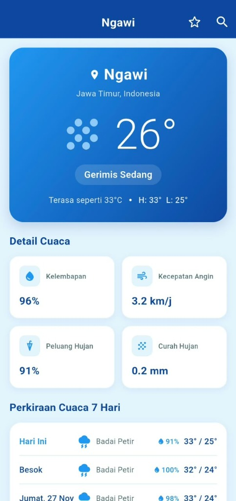
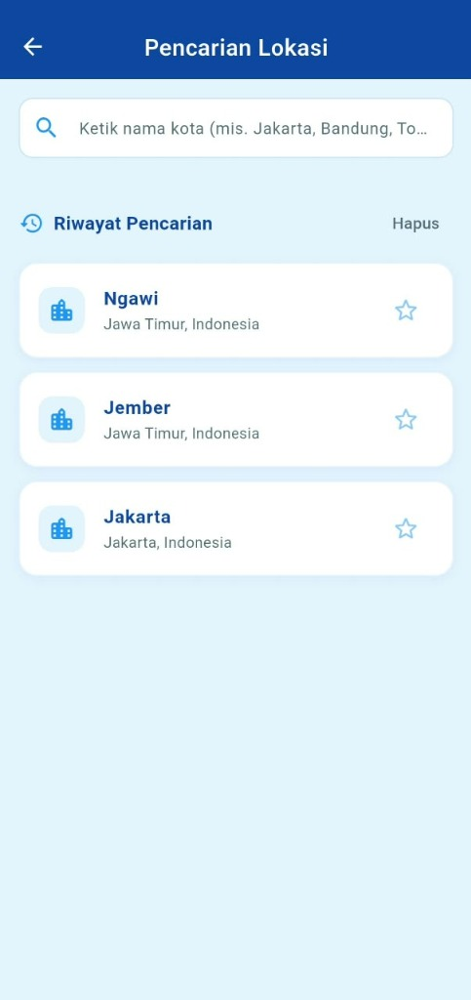

# Pawang Cuaca — Aplikasi Prakiraan Cuaca Flutter

Aplikasi prakiraan cuaca mobile berbasis **Flutter** dan **Dart** yang terintegrasi secara real-time dengan **Open-Meteo REST API**, menerapkan pola arsitektur **MVVM (Model-View-ViewModel)**, manajemen state **Provider**, serta penyimpanan lokal menggunakan **SharedPreferences**.

---

## Identitas Mahasiswa

| Keterangan | Detail |
| :--- | :--- |
| **Nama** | Yoga Adi Nugraha |
| **NIM** | H1D024118 |
| **Tugas** | Responsi Praktikum Pemrograman Mobile (Flutter) |

---

## Fitur Utama

- **Pencarian Kota Real-Time:** Mencari lokasi/kota di seluruh dunia menggunakan **Open-Meteo Geocoding API** dengan *debounce* `450ms` untuk efisiensi request.
- **Informasi Cuaca Terkini Lengkap:**
  - Suhu saat ini (`°C`) dan suhu yang dirasakan (*apparent temperature*)
  - Rentang suhu maksimum dan minimum harian
  - Kondisi cuaca lengkap dalam bahasa Indonesia beserta ikon representatif berdasarkan WMO `weather_code`
  - Detail atmosfer: kelembapan udara (`%`), kecepatan angin (`km/j`), peluang hujan (`%`), dan curah hujan (`mm`)
- **Prakiraan Cuaca 7 Hari:** Menampilkan ramalan harian (Hari Ini, Besok, dan hari berikutnya) beserta peluang hujan serta suhu maksimum/minimum.
- **Penyimpanan Lokal (`SharedPreferences`):**
  - Menyimpan dan menghapus **lokasi favorit** (bookmark bintang)
  - Menyimpan **riwayat pencarian** (maksimal 10 kota terakhir, dapat dibersihkan)
  - Menyimpan **lokasi terakhir yang dipilih** sehingga langsung dimuat kembali saat aplikasi dibuka
- **Penanganan State Komprehensif:** Menangani status `initial`, `loading`, `success`, `empty` (*Kota tidak ditemukan*), dan `error` (offline/HTTP error dengan tombol **Coba Lagi**).
- **Tema Material 3 Konsisten:** Menggunakan `ThemeData` terpusat dengan palet warna biru (`#E3F2FD`, `#90CAF9`, `#2196F3`, `#0D47A1`) dan `textTheme` yang mudah dibaca.

---

## Screenshot Tampilan Aplikasi

| Home Screen (Cuaca Terkini & 7 Hari) | Search Screen (Hasil Pencarian API) | Search Screen (Favorit & Riwayat) |
| :---: | :---: | :---: |
|  |  |  |

---

## Struktur Folder Proyek

```text
lib/
├── main.dart                          # Entry point, inisialisasi locale id_ID & MultiProvider
├── core/
│   ├── theme/
│   │   └── app_theme.dart             # Konfigurasi Material 3 Theme, AppColors & Typography
│   └── utils/
│       └── weather_code_mapper.dart   # Pemetaan WMO weather_code ke deskripsi & ikon Material
├── models/
│   ├── location_model.dart            # Model lokasi (id, koordinat, nama, wilayah, favorit)
│   ├── weather_model.dart             # Model cuaca terkini & metrik harian hari ini
│   └── daily_forecast_model.dart      # Model prakiraan harian 7 hari
├── services/
│   ├── geocoding_service.dart         # HTTP GET ke Open-Meteo Geocoding API
│   ├── weather_service.dart           # HTTP GET ke Open-Meteo Forecast API
│   └── local_storage_service.dart     # Penyimpanan lokal dengan SharedPreferences
├── repositories/
│   └── weather_repository.dart        # Abstraksi data antara Service dan ViewModel
├── viewmodels/
│   ├── weather_viewmodel.dart         # State & logika layar utama cuaca (ChangeNotifier)
│   └── search_viewmodel.dart          # State & logika pencarian, favorit & riwayat (ChangeNotifier)
└── views/
    ├── home_screen.dart               # Layar utama cuaca (Home / Weather Screen)
    ├── search_screen.dart             # Layar pencarian kota & favorit (Search / Location Screen)
    └── widgets/
        ├── current_weather_card.dart  # Kartu ringkasan cuaca terkini
        ├── weather_detail_item.dart   # Kartu detail kelembapan, angin, peluang & curah hujan
        ├── daily_forecast_tile.dart   # Daftar prakiraan cuaca 7 hari
        └── location_tile.dart         # Item daftar lokasi dengan tombol favorit
```

---

## Implementasi API Open-Meteo

Seluruh data lokasi dan cuaca diambil secara dinamis menggunakan metode **HTTP GET** melalui package `http`:

### 1. Geocoding API (Pencarian Lokasi)
- **Endpoint:** `https://geocoding-api.open-meteo.com/v1/search`
- **Parameter:**
  - `name`: nama kota yang dicari
  - `count`: `10`
  - `language`: `id`
  - `format`: `json`
- **Implementasi:** [geocoding_service.dart](lib/services/geocoding_service.dart)

### 2. Weather Forecast API (Cuaca Terkini & Harian)
- **Endpoint:** `https://api.open-meteo.com/v1/forecast`
- **Parameter:**
  - `latitude` & `longitude`: koordinat lokasi terpilih
  - `current`: `temperature_2m,relative_humidity_2m,apparent_temperature,precipitation,weather_code,wind_speed_10m`
  - `daily`: `weather_code,temperature_2m_max,temperature_2m_min,precipitation_probability_max`
  - `timezone`: `auto`
  - `forecast_days`: `7`
- **Implementasi:** [weather_service.dart](lib/services/weather_service.dart)

### Pemetaan Field API ke Model Dart
| Data | Field API | Model Dart |
| :--- | :--- | :--- |
| Suhu saat ini | `current.temperature_2m` | `WeatherModel.temperature` |
| Kelembapan | `current.relative_humidity_2m` | `WeatherModel.relativeHumidity` |
| Suhu dirasakan | `current.apparent_temperature` | `WeatherModel.apparentTemperature` |
| Curah hujan | `current.precipitation` | `WeatherModel.precipitation` |
| Kode kondisi cuaca | `current.weather_code` | `WeatherModel.weatherCode` |
| Kecepatan angin | `current.wind_speed_10m` | `WeatherModel.windSpeed` |
| Suhu maksimum harian | `daily.temperature_2m_max` | `DailyForecastModel.maxTemp` / `WeatherModel.todayMaxTemp` |
| Suhu minimum harian | `daily.temperature_2m_min` | `DailyForecastModel.minTemp` / `WeatherModel.todayMinTemp` |
| Peluang hujan maksimum | `daily.precipitation_probability_max` | `DailyForecastModel.precipitationProbability` / `WeatherModel.todayPrecipitationProbability` |

---

## Penerapan Arsitektur MVVM & State Management

1. **Model & Data Layer (`models/`, `services/`, `repositories/`):**
   - Menangani struktur data JSON ke objek Dart, request HTTP ke Open-Meteo, serta operasi baca/tulis `SharedPreferences`.
   - `WeatherRepository` menjadi penghubung antara `Service` dan `ViewModel` sekaligus menyinkronkan status favorit.
2. **ViewModel Layer (`viewmodels/`):**
   - `WeatherViewModel` dan `SearchViewModel` mewarisi `ChangeNotifier` tanpa bergantung pada `BuildContext` maupun komponen UI.
   - Mengelola perubahan status melalui `ViewState` (`initial`, `loading`, `success`, `empty`, `error`) dan memicu pembaruan UI via `notifyListeners()`.
3. **View Layer (`views/`):**
   - `HomeScreen` (`StatefulWidget`) dan `SearchScreen` (`StatefulWidget`) beserta widget pendukung hanya merender tampilan berdasarkan state ViewModel menggunakan `Consumer`, `context.watch`, dan `context.read`.

---

## Cara Menjalankan Proyek

1. **Clone repository:**
   ```bash
   git clone <URL_REPOSITORY_GITHUB_ANDA>
   cd responsi_pawangcuaca
   ```

2. **Unduh dependencies:**
   ```bash
   flutter pub get
   ```

3. **Jalankan unit test:**
   ```bash
   flutter test
   ```

4. **Jalankan aplikasi:**
   ```bash
   flutter run
   ```

---

## Video Penjelasan Kode

- **Link Video:** *Tambahkan link video YouTube / Google Drive Anda di sini*
